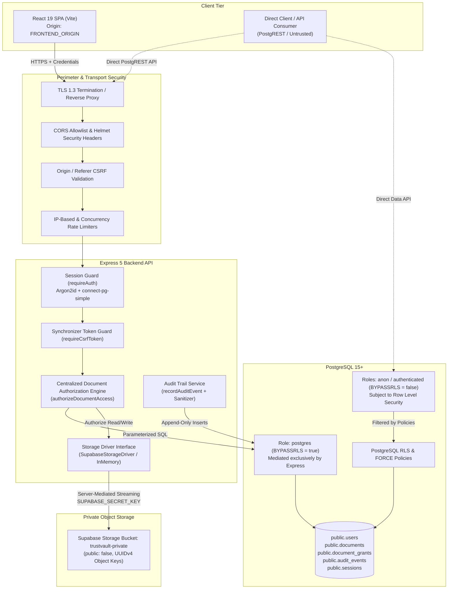
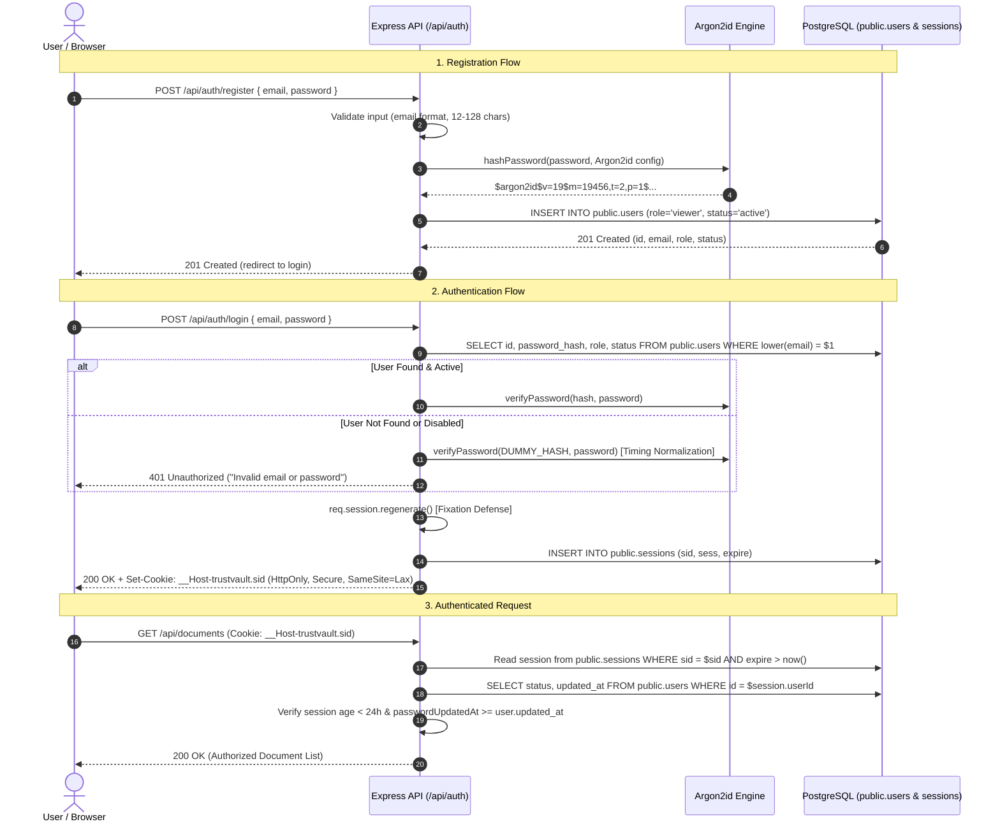
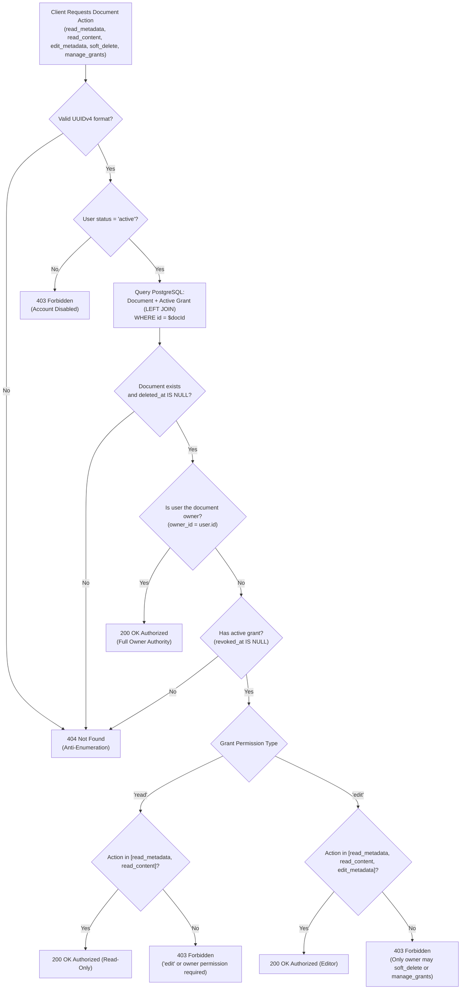
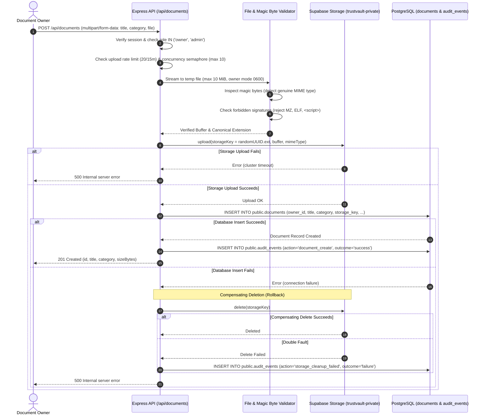
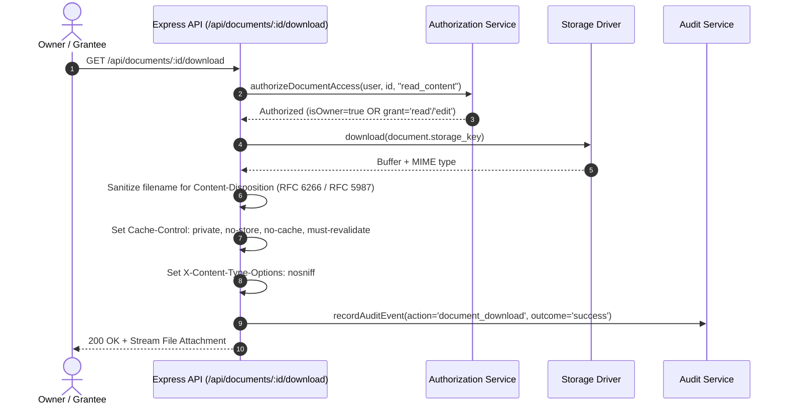

# TrustVault — Architecture & System Design

**Document Version:** 1.0.0  
**Target Environment:** Node.js 22+ (Express 5 backend), React 19 (Vite SPA), PostgreSQL 15+ (Supabase)  
**Status:** Implemented & Verified in Local Test Environment

---

## 1. System Overview

TrustVault is a secure, multi-tenant document-sharing platform engineered around zero-trust authorization, cryptographic defense-in-depth, and an immutable access audit trail. It addresses the critical vulnerability where applications inadvertently leak confidential files across tenant boundaries through insecure direct object references (IDOR), stale permission grants, or over-privileged administrative roles.



---

## 2. Core Architectural Responsibilities

| Tier | Component | Technology | Primary Responsibilities |
|:---|:---|:---|:---|
| **Frontend** | `apps/web` | React 19, Vite, Tailwind CSS v4, Base UI, React Router v7 | - Responsive user interface for authentication, document management, grant sharing, and audit log inspection.<br>- Client-side state management, CSRF token attachment (`x-csrf-token`), and secure cookie transmission.<br>- Never stores or evaluates business-critical authorization rules; mirrors server state. |
| **API Backend** | `apps/api` | Express 5, Node.js 22+, TypeScript, Zod | - Centralized authentication, session management, and CSRF defense.<br>- Parameterized authorization decisions independently of frontend parameters.<br>- File validation: magic byte verification, MIME detection, and streaming size limits.<br>- Mediated storage streaming: clients never receive direct storage credentials or public URLs.<br>- Append-only audit trail generation and metadata redaction. |
| **Database** | `supabase/` | PostgreSQL 15+ | - Authoritative persistence for users, documents, grants, sessions, and audit logs.<br>- Relational constraints: unique email index, single active grant index, and cascade safeguards.<br>- Defense-in-depth: Row Level Security (RLS) policies on all tables for non-bypass roles (`anon`, `authenticated`).<br>- Isolated `SECURITY DEFINER` helper functions with pinned `search_path = public`. |
| **Object Storage** | Supabase Storage | S3-compatible private bucket (`trustvault-private`) | - Binary file payload storage using unguessable server-generated UUIDv4 keys.<br>- Strictly private configuration (`public: false`); zero direct client access policies.<br>- Upload compensation and orphaned object reconciliation. |

---

## 3. Trust Boundaries & Security Enclaves

### Trust Boundary 1: Client to API Gateway
- **Assumption:** The web browser and all incoming network traffic are completely untrusted. Attackers may forge HTTP headers, tamper with request bodies, craft direct API calls, or replay expired sessions.
- **Enforcement:**
  - Strict CORS origin allowlist (`FRONTEND_ORIGIN`).
  - Origin / Referer validation (`validateOrigin`) on all state-changing requests (`POST`, `PUT`, `PATCH`, `DELETE`).
  - Session-bound synchronizer CSRF tokens (`requireCsrfToken`) verified with constant-time equality checks (`crypto.timingSafeEqual`).
  - Strict input schemas (`zod`) that reject extra fields (`.strict()`).
  - Rate limiting on authentication and file transfer endpoints.

### Trust Boundary 2: Express API to Database
- **Implementation Reality:** The Express API connects via a standard pooled database role (`postgres`) which holds the PostgreSQL `BYPASSRLS` attribute.
- **Architectural Consequence:** Database-level RLS does **not** evaluate queries issued by the Express backend. The backend is the authoritative security gateway and must explicitly enforce parameterized authorization on every query.
- **RLS Perimeter:** Database RLS acts as a secondary defense-in-depth perimeter against direct connections (such as PostgREST APIs exposed on port 54321/443, leaked restricted-role credentials, or potential future microservices operating under `anon` or `authenticated` roles).

### Trust Boundary 3: API Backend to Private Object Storage
- **Assumption:** Object storage must never be exposed to public web traffic.
- **Enforcement:**
  - The storage bucket (`trustvault-private`) is marked strictly private (`public: false`).
  - Clients never receive signed URLs, bucket tokens, or storage keys.
  - The backend streams files to and from storage using the server-held `SUPABASE_SECRET_KEY` only after verifying per-document permissions in PostgreSQL.
  - Storage keys are cryptographically random UUIDs (`crypto.randomUUID().ext`), eliminating path traversal and key enumeration.

---

## 4. Authentication & Session Lifecycle

TrustVault implements server-side, stateful session authentication backed by PostgreSQL (`connect-pg-simple`), completely independent of Supabase Auth.



### Authentication Invariants
1. **Password Hashing:** Passwords are hashed using Argon2id with OWASP parameters: 19 MiB memory cost, 2 iterations, 1 parallelism, 32-byte salt/digest. Concurrency is throttled to 10 simultaneous operations to prevent CPU exhaustion DoS.
2. **Enumeration Resistance:** Login failures execute dummy verification against a pre-computed hash (`DUMMY_HASH`) to normalize execution time between existing and non-existing accounts. Error responses are strictly uniform: `{"error": "Invalid email or password"}`.
3. **Session Fixation Prevention:** Calling `req.session.regenerate()` upon login replaces the unauthenticated session ID with a cryptographically fresh ID.
4. **Cookie Security:** In production, the session cookie uses the `__Host-` prefix, enforcing `Secure`, `HttpOnly`, `SameSite=Lax`, and `path=/` without a domain scope.
5. **Session Invalidation:**
   - **Idle Timeout:** 8 hours of inactivity (`rolling: true` resets on active requests).
   - **Absolute Timeout:** 24 hours from initial creation (`ABSOLUTE_SESSION_TIMEOUT_MS`).
   - **Password Rotation:** Changing passwords deletes all concurrent sessions from `public.sessions` (`(sess::jsonb)->>'userId' = $userId AND sid != $currentSid`).
   - **Account Disablement:** Every authenticated request queries the database to confirm `status = 'active'`; disabled accounts are terminated immediately.

---

## 5. Centralized Document Authorization Model

All document operations are mediated by the centralized authorization service: [authorizeDocumentAccess](file:///c:/Users/ruthv/Projects/trustvault/apps/api/src/documents/authorization.ts).



### Authorization Rules Matrix

| Role / Actor | Read Metadata | Stream Download | Edit Metadata | Soft Delete | Share / Revoke Grants | Query Audit Trail |
|:---|:---:|:---:|:---:|:---:|:---:|:---:|
| **Document Owner** | ✅ Allowed | ✅ Allowed | ✅ Allowed | ✅ Allowed | ✅ Allowed | ✅ Allowed (Document Scope) |
| **Active `edit` Grantee** | ✅ Allowed | ✅ Allowed | ✅ Allowed | ❌ Forbidden (403) | ❌ Forbidden (403) | ❌ Forbidden (403) |
| **Active `read` Grantee** | ✅ Allowed | ✅ Allowed | ❌ Forbidden (403) | ❌ Forbidden (403) | ❌ Forbidden (403) | ❌ Forbidden (403) |
| **Revoked Grantee** | ❌ Uniform 404 | ❌ Uniform 404 | ❌ Uniform 404 | ❌ Uniform 404 | ❌ Uniform 404 | ❌ Uniform 404 |
| **Unrelated User** | ❌ Uniform 404 | ❌ Uniform 404 | ❌ Uniform 404 | ❌ Uniform 404 | ❌ Uniform 404 | ❌ Uniform 404 |
| **System Administrator** | ❌ Uniform 404* | ❌ Uniform 404* | ❌ Uniform 404* | ❌ Uniform 404* | ❌ Uniform 404* | ✅ Allowed (System Scope) |

*\*Administrator Privacy Boundary:* TrustVault strictly enforces separation of concerns. The `admin` role provides system oversight of operational audit logs (`GET /api/audit`), but does **not** grant automatic backdoor read or download access to private documents. Admins require explicit document ownership or an active grant like any other user.

---

## 6. Document Upload & Lifecycle Architecture

Document creation involves a coordinated two-phase transaction across Supabase Storage and PostgreSQL.



### Storage Invariants & File Validation
1. **Magic Byte Verification:** The server inspects initial binary headers (`detectMimeTypeFromBuffer`) for approved signatures:
   - PDF: `%PDF-` (`0x25 0x50 0x44 0x46 0x2D`)
   - PNG: `0x89 0x50 0x4E 0x47 0x0D 0x0A 0x1A 0x0A`
   - JPEG: `0xFF 0xD8 0xFF`
   - WebP: `RIFF` ... `WEBP`
   - Office OOXML (DOCX/XLSX): `PK\x03\x04`
2. **Generic MIME Disallowance:** Declaring `application/octet-stream` is forbidden unless the underlying binary independently matches an allowlisted signature.
3. **Executable Rejection:** Rejects DOS `MZ` executables, Unix `\x7FELF` binaries, and active web scripts (`<script>`, `<?php`, `#!/bin/`) within text payloads.
4. **Size Bounds:** Strictly bounded to 10 MiB (`MAX_DOCUMENT_FILE_SIZE`). Empty files (0 bytes) are rejected with HTTP 400; files exceeding 10 MiB are terminated during streaming with HTTP 413.
5. **Orphan Reconciliation:** The utility `reconcileOrphanedObjects` scans storage buckets using pagination. It preserves objects younger than a 15-minute grace period (`gracePeriodMs`) to prevent race conditions with in-flight uploads, aborting immediately without deletions if pagination fails.

---

## 7. Download Streaming Architecture



---

## 8. Sharing & Grant Revocation Lifecycle

Sharing permissions are represented in PostgreSQL table `public.document_grants`.

1. **Owner Exclusivity:** Only the document owner can grant permissions (`POST /api/documents/:id/grants`), modify permissions (`PATCH /api/documents/:id/grants/:grantId`), or revoke access (`DELETE /api/documents/:id/grants/:grantId`).
2. **Grant Concurrency Safety:** Table `public.document_grants` contains a partial unique index:
   ```sql
   CREATE UNIQUE INDEX document_grants_one_active_idx
       ON public.document_grants (document_id, user_id)
       WHERE revoked_at IS NULL;
   ```
   This guarantees that at most one active grant can exist per user/document pair. Attempting to create duplicate active grants fails closed with HTTP 409 Conflict.
3. **Immediate Revocation:** Revoking a grant sets `revoked_at = now()` atomically. Subsequent authorization requests fail immediately with HTTP 404 anti-enumeration responses, with zero stale token caching.

---

## 9. Audit Trail Architecture & Tamper Resistance

Every security-sensitive operation across authentication, document access, sharing, and administration emits an event into `public.audit_events`.

### Implemented Guarantees
- **Append-Only Application Layer:** No `PUT`, `PATCH`, or `DELETE` endpoints exist for audit records. Non-GET requests to audit routes return HTTP 405 Method Not Allowed.
- **Server-Derived Attribution:** Authenticated events derive `actor_id` strictly from `req.user.id`. Client payloads cannot forge actor identities or timestamps (`occurred_at = now()`).
- **Metadata Sanitization:** The service allowlists permitted keys (`ALLOWED_METADATA_KEYS`), redacts credential-shaped strings (Bearer tokens, JWTs, password assignments, Argon2 hashes), and bounds text values to 500 characters.
- **Transactional Atomicity:** Mutating operations pass the active database client and `throwOnError: true` to ensure the business action rolls back if audit logging fails.

### Architectural Limitations
- **Database Superuser Boundary:** The database role used by Express (`postgres`) has table privileges. Append-only guarantees are enforced by application code and RLS policies (0 update/delete policies), but a database superuser or direct SQL console operator could theoretically execute raw SQL deletions. Cryptographic Merkle audit trees (RFC 6962) or external WORM storage are required for mathematical proof against privileged database administrators.

---

## 10. Multi-Tenant Architecture & Boundary Evaluation

TrustVault implements a **user-centric document tenancy model** with explicit per-document discretionary access control (DAC), rather than an organization- or workspace-level tenancy model.

### Multi-Tenancy Boundary Audit Findings

| Audit Question | System Reality | Architectural Details |
|:---|:---|:---|
| **1. Is there an organization or tenant entity?** | **No** | The schema contains `users`, `documents`, `document_grants`, `audit_events`, and `sessions`. There are no `organizations`, `tenants`, or `workspaces` tables. |
| **2. Can users belong to different organizations?** | **No** | Users register with an email address. There are no organization membership tables, domain-based tenant partitions, or multi-tenant user hierarchies. |
| **3. Are documents associated with a tenant?** | **User-Level Only** | Documents belong to an `owner_id` (a user UUID in `public.users`). The owner is the sole authority over the document enclave. |
| **4. Are document grants constrained by tenant boundaries?** | **Platform-Wide** | Any document owner can grant permissions (`read` or `edit`) to any registered user by their email address. |
| **5. Can an owner share a document with a user outside their intended tenant?** | **By Design** | Because tenants are user-centric enclaves, sharing is discretionary per document. There are no cross-organization boundary constraints. |
| **6. Can an admin see all users and documents?** | **Users: Yes; Documents: No** | Admins can list all users and audit logs. However, admins do **not** have implicit read or download access to documents they do not own. Zero-knowledge document isolation is preserved. |
| **7. Does storage access enforce tenant and document permissions?** | **Yes** | Storage objects are stored in private buckets (`public: false`) with random UUID keys. Direct storage access is blocked; downloads stream exclusively through server authorization. |
| **8. Can identifiers be substituted to access resources (IDOR)?** | **No** | Every document operation executes `authorizeDocumentAccess`. Non-owners without active grants receive uniform `HTTP 404 Not Found` responses. |

### Product & Migration Assessment
Introducing an organization-level tenant model would require a breaking database migration (`ALTER TABLE documents ADD COLUMN organization_id UUID NOT NULL`), an organizations table, tenant invitation workflows, and a complete rewrite of grant constraints and RLS policies. The current user-enclave model achieves complete document-level isolation, zero-knowledge administration, and strict IDOR prevention without unnecessary schema complexity.

---

## 11. Administrative User Governance & Session Lifecycle

Administrative user management is exposed via `/api/admin/users` and enforced independently on the server.

### Role Transition Rules
- Supported application roles: `admin`, `owner`, `viewer`.
- Public registration strictly assigns role `viewer` (`least privilege`).
- Role transitions are performed exclusively by authenticated administrators via `PATCH /api/admin/users/:id/role`.
- **Self-Demotion Safeguard:** An administrator cannot change their own role via the admin interface (`HTTP 400 Bad Request`).
- **Last-Admin Safeguard:** To prevent accidental lockout, the server queries active administrators before applying role or status modifications. If only one active administrator remains, demoting or disabling that administrator is rejected (`HTTP 400 Bad Request`).

### Account Disabling & Immediate Session Revocation
When an administrator disables an account via `PATCH /api/admin/users/:id/status` (`status: "disabled"`):
1. **Database Status Update:** `public.users.status` transitions from `'active'` to `'disabled'`.
2. **Server-Side Session Purge:** The server executes an immediate multi-session invalidation:
   ```sql
   DELETE FROM public.sessions WHERE (sess::jsonb)->>'userId' = $1
   ```
3. **Subsequent API Enforcement:** Any subsequent request presenting an existing session cookie is rejected with `HTTP 401 Unauthorized` (session destroyed). If a session was cached in memory, `requireAuth` queries PostgreSQL and rejects non-active users with `HTTP 403 Forbidden` (`"Account disabled"`).
4. **Data Preservation:** Disabling an account preserves all owned documents, active grants, and historical audit events intact.
5. **Audit Trail:** Disabling and re-enabling actions emit immutable `admin_change_status` audit events with actor attribution.
