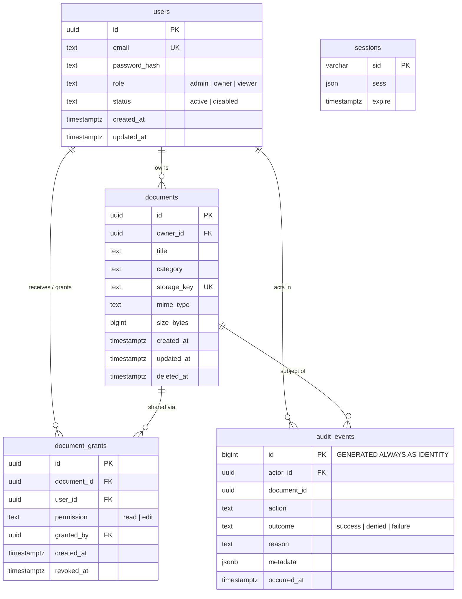

# TrustVault — Database Architecture, Schema & Row Level Security (RLS) Specification

This document provides the technical specification of the TrustVault PostgreSQL database schema, migrations, data integrity constraints, Row Level Security (RLS) architecture, and database role privileges. Every definition reflects the migrations located in [`supabase/migrations`](file:///c:/Users/ruthv/Projects/trustvault/supabase/migrations).

---

## 1. Database Architecture & Engine Overview

TrustVault uses **PostgreSQL 15+** (via Supabase PostgreSQL or standard PostgreSQL) with the `pgcrypto` extension for cryptographic UUID generation (`gen_random_uuid()`).

### Core Design Principles
1. **Strong Typing & Domain Invariants:** Every identifier is a UUID or identity sequence; text columns are bounded with `CHECK` constraints; timestamps are timezone-aware (`TIMESTAMPTZ`) with `DEFAULT now()`.
2. **Authoritative Account Status:** The `public.users` table uses a dedicated column named **`status`** with an explicit constraint `CHECK (status IN ('active', 'disabled'))`. *(Note: The schema does NOT use an `is_active` boolean).*
3. **Soft Deletions:** Documents utilize `deleted_at TIMESTAMPTZ` for non-destructive lifecycle management. All user-facing queries and active indexes filter `WHERE deleted_at IS NULL`.
4. **Append-Only Audit Trail:** `public.audit_events` uses an auto-incrementing identity column (`BIGINT GENERATED ALWAYS AS IDENTITY`). No update or delete operations are permitted.
5. **Partial Indexes for Active Records:** Indexes on document grants and documents enforce uniqueness and high query performance exclusively over active records (`WHERE revoked_at IS NULL` and `WHERE deleted_at IS NULL`).

---

## 2. Migration History & Application Sequence

Migrations must be executed in strict lexicographical order:

| Step | Migration File | Description | Target Environment |
|:---|:---|:---|:---|
| 1 | [`supabase/migrations/20261020161159_create_trustvault_schema.sql`](file:///c:/Users/ruthv/Projects/trustvault/supabase/migrations/20261020161159_create_trustvault_schema.sql) | Base schema: creates tables `users`, `documents`, `document_grants`, `audit_events`, `sessions`, and corresponding indexes and check constraints. | Tested in `trustvault_test`; Ready for production. |
| 2 | [`supabase/migrations/20261024103000_enable_row_level_security.sql`](file:///c:/Users/ruthv/Projects/trustvault/supabase/migrations/20261024103000_enable_row_level_security.sql) | Row Level Security (RLS): enables and forces RLS on all tables, defines `auth.uid()`, `SECURITY DEFINER` helper functions, immutable column trigger, and policies. | Tested in `trustvault_test`; Pending production migration. |

> [!IMPORTANT]
> **Production Status:** The RLS migration has been thoroughly verified against the isolated test database `trustvault_test` (24 passing integration tests in [`apps/api/tests/integration/rls.test.ts`](file:///c:/Users/ruthv/Projects/trustvault/apps/api/tests/integration/rls.test.ts)). It has **not yet been applied to the live production database**. See Section 7 for the verified, non-destructive migration execution procedure.

---

## 3. Comprehensive Schema & Table Reference

### A. Table `public.users`
Stores user identities, credentials, authorization roles, and account status.

```sql
CREATE TABLE public.users (
    id UUID PRIMARY KEY DEFAULT gen_random_uuid(),
    email TEXT NOT NULL,
    password_hash TEXT NOT NULL,
    role TEXT NOT NULL
        CHECK (role IN ('admin', 'owner', 'viewer')),
    status TEXT NOT NULL DEFAULT 'active'
        CHECK (status IN ('active', 'disabled')),
    created_at TIMESTAMPTZ NOT NULL DEFAULT now(),
    updated_at TIMESTAMPTZ NOT NULL DEFAULT now()
);
```

- **Columns:**
  - `id` (`UUID`, PK): Cryptographically random unique user identifier.
  - `email` (`TEXT`, NOT NULL): User email address.
  - `password_hash` (`TEXT`, NOT NULL): Argon2id password hash (`$argon2id$v=19$m=19456,t=2,p=1$...`).
  - `role` (`TEXT`, NOT NULL): Application role (`'admin'`, `'owner'`, `'viewer'`).
  - `status` (`TEXT`, NOT NULL, default `'active'`): Account operational state (`'active'` or `'disabled'`).
  - `created_at` (`TIMESTAMPTZ`, default `now()`): Account registration timestamp.
  - `updated_at` (`TIMESTAMPTZ`, default `now()`): Timestamp of last credential update.
- **Indexes & Constraints:**
  - `users_email_lower_unique` (`UNIQUE INDEX` on `lower(email)`): Enforces case-insensitive email uniqueness.
  - `users_role_check`: `role IN ('admin', 'owner', 'viewer')`.
  - `users_status_check`: `status IN ('active', 'disabled')`.

---

### B. Table `public.documents`
Stores document metadata, ownership, categorization, and references to private object storage.

```sql
CREATE TABLE public.documents (
    id UUID PRIMARY KEY DEFAULT gen_random_uuid(),
    owner_id UUID NOT NULL REFERENCES public.users(id),
    title TEXT NOT NULL CHECK (length(trim(title)) BETWEEN 1 AND 200),
    category TEXT NOT NULL CHECK (length(trim(category)) BETWEEN 1 AND 100),
    storage_key TEXT NOT NULL UNIQUE,
    mime_type TEXT NOT NULL,
    size_bytes BIGINT NOT NULL CHECK (size_bytes > 0),
    created_at TIMESTAMPTZ NOT NULL DEFAULT now(),
    updated_at TIMESTAMPTZ NOT NULL DEFAULT now(),
    deleted_at TIMESTAMPTZ
);
```

- **Columns:**
  - `id` (`UUID`, PK): Unique document identifier.
  - `owner_id` (`UUID`, FK $\rightarrow$ `users(id)`): Identity of document owner.
  - `title` (`TEXT`, NOT NULL): Human-readable title (1–200 characters).
  - `category` (`TEXT`, NOT NULL): Organizational category (1–100 characters).
  - `storage_key` (`TEXT`, NOT NULL, UNIQUE): Private object storage key in Supabase Storage. Generated exclusively on the server as a UUID (`generateSecureStorageKey`).
  - `mime_type` (`TEXT`, NOT NULL): Validated MIME type (e.g. `application/pdf`).
  - `size_bytes` (`BIGINT`, NOT NULL): File payload size in bytes ($> 0$).
  - `created_at` (`TIMESTAMPTZ`, default `now()`): Creation timestamp.
  - `updated_at` (`TIMESTAMPTZ`, default `now()`): Last metadata modification timestamp.
  - `deleted_at` (`TIMESTAMPTZ`, NULL): Soft-deletion timestamp. When set, document is considered non-existent for standard operations.
- **Indexes & Constraints:**
  - `documents_owner_created_idx` (`INDEX` on `(owner_id, created_at DESC) WHERE deleted_at IS NULL`): Optimized index for owner document listings.
  - `documents_category_idx` (`INDEX` on `(category) WHERE deleted_at IS NULL`): Optimized index for category filtering.
  - `documents_storage_key_key` (`UNIQUE` on `storage_key`): Guarantees 1:1 mapping between database records and storage objects.

---

### C. Table `public.document_grants`
Maintains granular per-document sharing permissions granted by document owners to other users.

```sql
CREATE TABLE public.document_grants (
    id UUID PRIMARY KEY DEFAULT gen_random_uuid(),
    document_id UUID NOT NULL REFERENCES public.documents(id),
    user_id UUID NOT NULL REFERENCES public.users(id),
    permission TEXT NOT NULL
        CHECK (permission IN ('read', 'edit')),
    granted_by UUID NOT NULL REFERENCES public.users(id),
    created_at TIMESTAMPTZ NOT NULL DEFAULT now(),
    revoked_at TIMESTAMPTZ
);
```

- **Columns:**
  - `id` (`UUID`, PK): Unique grant identifier.
  - `document_id` (`UUID`, FK $\rightarrow$ `documents(id)`): Referenced document.
  - `user_id` (`UUID`, FK $\rightarrow$ `users(id)`): Recipient user receiving access.
  - `permission` (`TEXT`, NOT NULL): Access level (`'read'` or `'edit'`).
  - `granted_by` (`UUID`, FK $\rightarrow$ `users(id)`): Owner who created the grant.
  - `created_at` (`TIMESTAMPTZ`, default `now()`): Grant issuance timestamp.
  - `revoked_at` (`TIMESTAMPTZ`, NULL): Grant revocation timestamp. `NULL` denotes an active grant; non-`NULL` denotes revoked access.
- **Indexes & Constraints:**
  - `document_grants_one_active_idx` (`UNIQUE INDEX` on `(document_id, user_id) WHERE revoked_at IS NULL`): **Strict invariant:** Guarantees at most one active grant exists for any user/document pair.
  - `document_grants_user_active_idx` (`INDEX` on `(user_id, document_id) WHERE revoked_at IS NULL`): Accelerated index for recipient document lookups.

---

### D. Table `public.audit_events`
Immutable, append-only log of security-sensitive operations and access decisions.

```sql
CREATE TABLE public.audit_events (
    id BIGINT GENERATED ALWAYS AS IDENTITY PRIMARY KEY,
    actor_id UUID REFERENCES public.users(id) ON DELETE SET NULL,
    document_id UUID,
    action TEXT NOT NULL,
    outcome TEXT NOT NULL
        CHECK (outcome IN ('success', 'denied', 'failure')),
    reason TEXT,
    metadata JSONB NOT NULL DEFAULT '{}'::jsonb
        CHECK (jsonb_typeof(metadata) = 'object'),
    occurred_at TIMESTAMPTZ NOT NULL DEFAULT now()
);
```

- **Columns:**
  - `id` (`BIGINT`, PK): Strictly ascending, immutable identity sequence.
  - `actor_id` (`UUID`, FK $\rightarrow$ `users(id)` ON DELETE SET NULL): Acting user. `NULL` for pre-authentication events (e.g. unknown login attempt).
  - `document_id` (`UUID`, NULL): Affected document identifier (unconstrained by FK so audit logs survive document cleanup).
  - `action` (`TEXT`, NOT NULL): Action identifier (e.g. `auth_login`, `download_content`, `create_grant`).
  - `outcome` (`TEXT`, NOT NULL): Decision outcome (`'success'`, `'denied'`, `'failure'`).
  - `reason` (`TEXT`, NULL): Safe, non-enumerating reason for denials.
  - `metadata` (`JSONB`, NOT NULL, default `'{}'`): Sanitized, allowlisted contextual metadata.
  - `occurred_at` (`TIMESTAMPTZ`, default `now()`): Authoritative event timestamp generated by PostgreSQL.
- **Indexes & Constraints:**
  - `audit_events_document_time_idx` (`INDEX` on `(document_id, occurred_at DESC)`): Document-scoped audit inspection.
  - `audit_events_actor_time_idx` (`INDEX` on `(actor_id, occurred_at DESC)`): Actor activity analysis.
  - `audit_events_time_idx` (`INDEX` on `(occurred_at DESC)`): System-wide administrative audit inspection.

---

### E. Table `public.sessions`
PostgreSQL session store used by Express session management (`connect-pg-simple`).

```sql
CREATE TABLE public.sessions (
    sid VARCHAR NOT NULL PRIMARY KEY,
    sess JSON NOT NULL,
    expire TIMESTAMPTZ NOT NULL
);
```

- **Columns:**
  - `sid` (`VARCHAR`, PK): Express session ID.
  - `sess` (`JSON`, NOT NULL): Session payload containing `userId`, `role`, `createdAt`, `passwordUpdatedAt`, and CSRF secret.
  - `expire` (`TIMESTAMPTZ`, NOT NULL): Session expiration timestamp.
- **Indexes:**
  - `sessions_expire_idx` (`INDEX` on `expire`): Automated expiration pruning.

---

## 4. Entity-Relationship Diagram



---

## 5. Row Level Security (RLS) Architecture & Policies

The RLS migration ([`supabase/migrations/20261024103000_enable_row_level_security.sql`](file:///c:/Users/ruthv/Projects/trustvault/supabase/migrations/20261024103000_enable_row_level_security.sql)) activates defense-in-depth protection for all tables.

### A. RLS Activation & Enforcement
All tables enforce strict Row Level Security, including for table owners:
```sql
ALTER TABLE public.users ENABLE ROW LEVEL SECURITY;
ALTER TABLE public.users FORCE ROW LEVEL SECURITY;

ALTER TABLE public.documents ENABLE ROW LEVEL SECURITY;
ALTER TABLE public.documents FORCE ROW LEVEL SECURITY;

ALTER TABLE public.document_grants ENABLE ROW LEVEL SECURITY;
ALTER TABLE public.document_grants FORCE ROW LEVEL SECURITY;

ALTER TABLE public.audit_events ENABLE ROW LEVEL SECURITY;
ALTER TABLE public.audit_events FORCE ROW LEVEL SECURITY;

ALTER TABLE public.sessions ENABLE ROW LEVEL SECURITY;
ALTER TABLE public.sessions FORCE ROW LEVEL SECURITY;
```

---

### B. Helper & `SECURITY DEFINER` Functions
To evaluate complex authorization policies without causing infinite recursion in RLS subqueries, six `SECURITY DEFINER` functions are created in the `public` schema. All functions strictly enforce `SET search_path = public` to mitigate search-path hijacking:

1. **`auth.uid()` (`STABLE`):**
   Extracts user identity from Supabase PostgREST JWT claims (`request.jwt.claim.sub` or `request.jwt.claims->>'sub'`) or session variable `trustvault.current_user_id` (used during testing).
2. **`public.is_admin()` (`SECURITY DEFINER`, `STABLE`):**
   Returns `true` if `auth.uid()` exists in `public.users` with `role = 'admin'` and `status = 'active'`.
3. **`public.user_role()` (`SECURITY DEFINER`, `STABLE`):**
   Returns the current active user's role from `public.users`.
4. **`public.is_document_owner(p_document_id uuid, p_user_id uuid)` (`SECURITY DEFINER`, `STABLE`):**
   Checks whether `p_document_id` is owned by `p_user_id` and has not been soft-deleted (`deleted_at IS NULL`).
5. **`public.document_owner(p_document_id uuid)` (`SECURITY DEFINER`, `STABLE`):**
   Returns the `owner_id` for a given document.
6. **`public.has_document_grant(p_document_id uuid, p_user_id uuid)` (`SECURITY DEFINER`, `STABLE`):**
   Checks whether `p_user_id` has an active grant (`revoked_at IS NULL`) for `p_document_id`.
7. **`public.has_document_edit_grant(p_document_id uuid, p_user_id uuid)` (`SECURITY DEFINER`, `STABLE`):**
   Checks whether `p_user_id` has an active grant with `permission = 'edit'` for `p_document_id`.

#### Permission Restrictions on Functions:
`PUBLIC` and role `anon` have `EXECUTE` privileges explicitly revoked. Execution is granted exclusively to `authenticated`, `service_role`, and test roles:
```sql
REVOKE EXECUTE ON FUNCTION public.is_document_owner(uuid, uuid) FROM PUBLIC, anon;
GRANT EXECUTE ON FUNCTION public.is_document_owner(uuid, uuid) TO authenticated, service_role;
```

---

### C. Trigger for Storage Metadata Immutability
To prevent non-service roles from tampering with private storage keys or file properties via SQL updates, a `BEFORE UPDATE` trigger enforces immutability on `storage_key`, `mime_type`, and `size_bytes`:

```sql
CREATE OR REPLACE FUNCTION public.check_documents_immutable_columns()
RETURNS trigger
LANGUAGE plpgsql
SET search_path = public
AS $$
BEGIN
  IF (NEW.storage_key IS DISTINCT FROM OLD.storage_key) OR
     (NEW.mime_type IS DISTINCT FROM OLD.mime_type) OR
     (NEW.size_bytes IS DISTINCT FROM OLD.size_bytes) THEN

    IF CURRENT_USER IN ('postgres', 'service_role', 'supabase_admin')
       OR (NULLIF(current_setting('request.jwt.claim.role', true), '') = 'service_role')
       OR (SELECT rolbypassrls FROM pg_roles WHERE rolname = CURRENT_USER) THEN
      RETURN NEW;
    END IF;

    RAISE EXCEPTION 'Cannot modify storage_key, mime_type, or size_bytes: immutable for non-service roles'
      USING ERRCODE = '42501';
  END IF;
  RETURN NEW;
END;
$$;
```

---

### D. Policy Matrix by Table

| Table | Operation | Policy Name | Predicate / Check Rule |
|:---|:---|:---|:---|
| **`users`** | `SELECT` | `users_select_policy` | `auth.uid() = id OR public.is_admin()` |
| | `INSERT` | `users_insert_policy` | `public.is_admin()` *(public registration handled by API)* |
| | `UPDATE` | `users_update_policy` | `auth.uid() = id OR public.is_admin()`; Non-admins cannot alter their own `role`. |
| | `DELETE` | `users_delete_policy` | `public.is_admin()` |
| **`documents`** | `SELECT` | `documents_select_policy` | `(deleted_at IS NULL AND (owner_id = auth.uid() OR has_document_grant(id, auth.uid()))) OR is_document_owner(id, auth.uid())` |
| | `INSERT` | `documents_insert_policy` | `owner_id = auth.uid() AND deleted_at IS NULL AND user_role() IN ('owner', 'admin')` |
| | `UPDATE` | `documents_update_policy` | Owner can update title/category, transfer, soft-delete; Edit grantee can only update title/category on un-deleted document. |
| | `DELETE` | `documents_delete_policy` | `owner_id = auth.uid()` |
| **`document_grants`** | `SELECT` | `document_grants_select_policy` | Document owner can see all grants; grantee can see their own active grant. |
| | `INSERT` | `document_grants_insert_policy` | Only document owner; `user_id != auth.uid()`; `revoked_at IS NULL`. |
| | `UPDATE` | `document_grants_update_policy` | Only document owner. |
| | `DELETE` | `document_grants_delete_policy` | Only document owner. |
| **`audit_events`** | `SELECT` | `audit_events_select_policy` | `public.is_admin() OR (document_id IS NOT NULL AND is_document_owner(document_id, auth.uid()))` |
| | `INSERT` | `audit_events_insert_policy` | Service-role / postgres can insert any; Clients require `actor_id = auth.uid()` and access to `document_id`. |
| | `UPDATE` | *(None)* | **Zero update policies (Append-Only Enforced).** |
| | `DELETE` | *(None)* | **Zero delete policies (Append-Only Enforced).** |
| **`sessions`** | `ALL` | *(None)* | **Zero policies (Default Deny for anon/authenticated).** All direct privileges revoked. |

---

## 6. PostgreSQL Database Roles, Privileges & `BYPASSRLS` Boundary

Understanding the database connection role is critical for evaluating security guarantees:

### The Application Connection Role
- In development and standard deployments, the Express API connects via `DATABASE_URL` using the **`postgres`** user.
- In PostgreSQL (and managed Supabase), the `postgres` role has `rolbypassrls = true`.
- **Implication:** PostgreSQL does **not** evaluate RLS policies on queries executed through the `postgres` connection pool.

```
┌─────────────────────────────────────────────────────────────────────────┐
│                      TRUSTVAULT TWO-TIER ACCESS MODEL                   │
├─────────────────────────────────────────────────────────────────────────┤
│                                                                         │
│   TIER 1: Primary Server-Side Authorization                             │
│   • Express API connects via DATABASE_URL ('postgres' role with        │
│     rolbypassrls = true).                                               │
│   • authorizeDocumentAccess() evaluates ownership, grants, account      │
│     status, and soft-deletion in code with parameterized SQL.           │
│   • Anti-enumeration (404), CSRF, rate-limiting, and validation occur   │
│     before any query touches the database.                              │
│                                                                         │
│   TIER 2: PostgreSQL Row Level Security (Defense-in-Depth)              │
│   • Applies to all non-bypass database connections (such as             │
│     Supabase PostgREST, anon, authenticated, or read-only roles).       │
│   • Enforces default-deny at the SQL engine level.                      │
│   • Guarantees that direct client access cannot bypass document         │
│     sharing or read unauthorized rows.                                  │
│                                                                         │
└─────────────────────────────────────────────────────────────────────────┘
```

### Direct Supabase Storage vs PostgreSQL RLS
There is a fundamental difference between table RLS and storage policies:
- **Application Tables (`public.*`):** Governed by the policies detailed in Section 5.
- **Storage Objects (`storage.objects`):** Managed by Supabase Storage in the `storage` schema. The bucket `trustvault-private` is created as `public: false`. Zero permissive policies exist for `anon` or `authenticated` on this bucket. Therefore, direct client requests to Supabase Storage are rejected with HTTP 403. All object access is mediated exclusively by the Express API using the server-held secret key (`SUPABASE_SECRET_KEY`).

---

## 7. Migration Application & Verification Procedure

To apply database migrations safely without risking data loss or downtime:

### Step 1: Pre-Flight Target Database Verification
Verify which database your tooling is connected to:
```bash
# Verify connection host and database name (Windows PowerShell)
npm run db:check --workspace=apps/api
```
Ensure the database name matches your intended target environment (`trustvault` for production, `trustvault_test` for testing).

### Step 2: Check Existing Migration State
Inspect the `supabase_migrations.schema_migrations` table:
```sql
SELECT version FROM supabase_migrations.schema_migrations ORDER BY version;
```

### Step 3: Apply Migrations Sequentially
```bash
# For local testing database:
npm run db:migrate:test --workspace=apps/api

# For Supabase remote project (via Supabase CLI):
# supabase db push --dry-run
# supabase db push
```

### Step 4: Post-Migration RLS Verification Query
Execute the following verification query to confirm RLS is active across all tables:
```sql
SELECT
    tablename,
    rowsecurity AS rls_enabled,
    forcerowsecurity AS rls_forced
FROM pg_tables
WHERE schemaname = 'public'
  AND tablename IN ('users', 'documents', 'document_grants', 'audit_events', 'sessions');
```
**Expected Result:** `rls_enabled = true` and `rls_forced = true` for all five tables.
