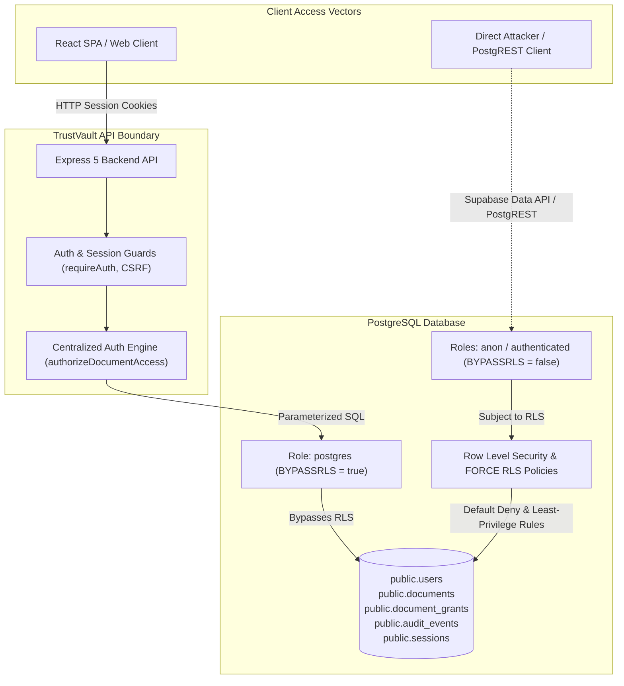

# TrustVault — Row Level Security (RLS) Audit and Secure Implementation Report

**Date:** 2026-10-24  
**Project:** TrustVault  
**Environment:** Monorepo (`apps/api`, `apps/web`, `supabase`)  

---

## Executive Summary

Before production deployment, a comprehensive security audit of TrustVault's PostgreSQL database schema, database roles, Supabase Storage buckets, and authorization architecture was performed. 

Prior to this implementation, Row Level Security (RLS) was **not enabled** on any application tables (`public.users`, `public.documents`, `public.document_grants`, `public.audit_events`, and `public.sessions`). Although the Express API rigorously enforces server-side authorization through parameterized SQL, session guards, and CSRF protection, the absence of database-level RLS meant that any direct database connection (such as Supabase's auto-exposed PostgREST Data API roles `anon` and `authenticated`) could read or tamper with user credentials, confidential documents, and audit logs.

A non-destructive, idempotent migration (`supabase/migrations/20261024103000_enable_row_level_security.sql`) was developed and applied strictly against an isolated local test database. Comprehensive regression test suites (18 dedicated RLS tests; 203 automated tests overall) verify that least-privilege policies protect against direct unauthorized access, cross-tenant leaks, grant tampering, and audit modifications without impacting the Express API connection.

---

## 1. Database Role & Connection Model Audit

### Effective Connection Privileges

| Context | Role | Superuser? | BYPASSRLS? | Effective Privilege & Behavior |
|:---|:---|:---|:---|:---|
| **Development & Production (Express API)** | `postgres` | `false` | `true` | Connects over standard PostgreSQL pooling (`pg.Pool`). Bypasses table-level RLS due to `rolbypassrls = true`. |
| **Local Automated Tests (Vitest)** | `trustvault` | `true` | `true` | Isolated test runner identity with superuser and bypass privileges. Unaffected by RLS for standard test runs and cleanup fixtures. |
| **Direct Client / Data API (Supabase)** | `anon` | `false` | `false` | Anonymous external client accessing PostgREST. Subject to RLS default-deny. |
| **Direct Client / Data API (Supabase)** | `authenticated`| `false` | `false` | Authenticated client with Supabase JWT (`auth.uid()`). Subject to RLS policies. |
| **Restricted Database Role (Simulated)** | `trustvault_restricted_tester` | `false` | `false` | Used in regression tests to verify exact RLS enforcement for non-bypass roles. |

> [!IMPORTANT]
> **API Role vs. Database RLS Distinction:**
> Because the Express API connects via a database role with the `BYPASSRLS` attribute (`postgres`), **database-level RLS does not filter queries executed by the Express server**. 
> The Express application relies on its centralized server-side authorization layer (`requireAuth`, `requireRole`, `authorizeDocumentAccess`, `validateOrigin`, and parameterized SQL). 
> **RLS acts as a defense-in-depth perimeter for roles that do not bypass RLS**: it prevents cross-tenant leaks, account harvesting, and data tampering if attackers attempt direct access via PostgREST, GraphQL endpoints, or future restricted-role connections. Compromise of privileged database credentials (such as roles with the `BYPASSRLS` attribute) remains out of scope for database-level RLS protections.



---

## 2. Table-by-Table RLS Audit & Policy Architecture

### Summary of Audited Tables

| Table | Prior Status | New Status | Effective Policies |
|:---|:---|:---|:---|
| `public.users` | RLS Disabled | `ENABLE & FORCE RLS` | `users_select_policy`<br>`users_insert_policy`<br>`users_update_policy`<br>`users_delete_policy` |
| `public.documents` | RLS Disabled | `ENABLE & FORCE RLS` | `documents_select_policy`<br>`documents_insert_policy`<br>`documents_update_policy`<br>`documents_delete_policy` |
| `public.document_grants` | RLS Disabled | `ENABLE & FORCE RLS` | `document_grants_select_policy`<br>`document_grants_insert_policy`<br>`document_grants_update_policy`<br>`document_grants_delete_policy` |
| `public.audit_events` | RLS Disabled | `ENABLE & FORCE RLS` | `audit_events_select_policy`<br>`audit_events_insert_policy`<br>*(Zero UPDATE or DELETE policies)* |
| `public.sessions` | RLS Disabled | `ENABLE & FORCE RLS` | *(Zero policies: Default Deny for direct client access)* |
| `storage.objects` | RLS Enabled (0 policies) | RLS Enabled | Default-deny for bucket `trustvault-private`. All uploads/downloads mediated via server. |

---

### Detailed Table Policies & Invariants

#### 1. `public.users`
- **Threat Mitigated:** Unauthorized harvesting of Argon2id password hashes; privilege escalation via self-assigning `role = 'admin'` or `role = 'owner'`.
- **Policies:**
  - **SELECT (`users_select_policy`):** `auth.uid() = id OR public.is_admin()`. Users can inspect only their own profile. Anonymous users see 0 rows.
  - **INSERT (`users_insert_policy`):** `public.is_admin()`. Direct account creation via SQL is strictly reserved for administrators; standard registration is processed through server-side validation.
  - **UPDATE (`users_update_policy`):** `USING (auth.uid() = id OR public.is_admin()) WITH CHECK ((auth.uid() = id AND (public.is_admin() OR role = public.user_role())) OR public.is_admin())`. A non-admin user cannot change their assigned role.
  - **DELETE (`users_delete_policy`):** `public.is_admin()`. Restricted strictly to administrators.

#### 2. `public.documents`
- **Threat Mitigated:** Insecure Direct Object References (IDOR); cross-tenant data leaks via SQL queries; unauthorized deletion or tampering by viewers.
- **Policies:**
  - **SELECT (`documents_select_policy`):** `(deleted_at IS NULL AND (owner_id = auth.uid() OR public.has_document_grant(documents.id, auth.uid()))) OR public.is_document_owner(documents.id, auth.uid())`.
  - **INSERT (`documents_insert_policy`):** Caller must be owner (`owner_id = auth.uid()`), document must not be soft-deleted, and user role must be `'owner'` or `'admin'` (`public.user_role() IN ('owner', 'admin')`).
  - **UPDATE (`documents_update_policy`):** 
    - Row-level update policy ensures:
      - Authenticated owner can update rows and complete ownership transfers or soft-deletion: `public.is_document_owner(documents.id, auth.uid())`.
      - Active `edit` grantee can update rows, but is strictly blocked from changing ownership (`owner_id = public.document_owner(documents.id)`) and cannot soft-delete (`deleted_at IS NULL`).
    - Storage metadata protection: Updating protected storage fields (`storage_key`, `mime_type`, `size_bytes`) is **not** handled by the row policy itself, but is strictly prevented for all non-service roles (including `authenticated` and `trustvault_restricted_tester`) via the `trg_documents_immutable_columns` `BEFORE UPDATE` trigger function (`check_documents_immutable_columns()`).
  - **DELETE (`documents_delete_policy`):** `owner_id = auth.uid()`.

#### 3. `public.document_grants`
- **Threat Mitigated:** Unauthorized permission granting; self-granting access to documents; tampering with revocation timestamps.
- **Policies:**
  - **SELECT (`document_grants_select_policy`):** Permitted if caller is document owner (`public.is_document_owner(document_id, auth.uid())`) OR grantee viewing their active grant (`user_id = auth.uid() AND revoked_at IS NULL`).
  - **INSERT (`document_grants_insert_policy`):** Only document owner can create grants. Disallows self-granting (`user_id != auth.uid()`). Enforces `granted_by = auth.uid()` and `revoked_at IS NULL`.
  - **UPDATE (`document_grants_update_policy`):** Strictly restricted to document owner (`public.is_document_owner(document_id, auth.uid())`).
  - **DELETE (`document_grants_delete_policy`):** Strictly restricted to document owner.

#### 4. `public.audit_events`
- **Threat Mitigated:** Audit log tampering, log deletion, and cross-tenant disclosure of confidential activity records.
- **Policies:**
  - **SELECT (`audit_events_select_policy`):** System admins (`public.is_admin()`) can view all audit records. Document owners can view audit records for documents they own (`public.is_document_owner(document_id, auth.uid())`). Ordinary viewers and grantees cannot read audit records.
  - **INSERT (`audit_events_insert_policy`):** 
    - Client inserts: Strictly require `actor_id IS NOT NULL` and require the caller to either be an administrator (`public.is_admin()`) or an authenticated actor matching `auth.uid()` (`actor_id = auth.uid()`) with verified document access (`document_id IS NULL OR public.is_document_owner(document_id, auth.uid()) OR public.has_document_grant(document_id, auth.uid())`). Direct client inserts with `actor_id IS NULL` are explicitly rejected.
    - System writes: Null-actor system events (`actor_id IS NULL`) are permitted exclusively through server-only roles (`postgres`, `service_role`, `supabase_admin`) or an authenticated system identity (`request.jwt.claim.role = 'service_role'`).
    - Effective Grants & Direct Inserts: Direct `INSERT` on `public.audit_events` is revoked from `anon`. For `authenticated`, direct inserts are subject to `audit_events_insert_policy` and fail closed against missing/spoofed actor IDs, null actor IDs, or unauthorized document references.
  - **UPDATE:** **ZERO POLICIES.** Update operations are universally rejected by RLS default-deny.
  - **DELETE:** **ZERO POLICIES.** Delete operations are universally rejected by RLS default-deny.

#### 5. `public.sessions`
- **Threat Mitigated:** Session hijacking, cookie enumeration, and direct token theft via Data APIs.
- **Policies:**
  - **ZERO POLICIES.** By enabling RLS and leaving no permissive policies, direct client access (`anon`, `authenticated`, and `public`) is completely denied.
  - Privilege revocation: `REVOKE ALL ON public.sessions FROM anon, authenticated;`.

---

## 3. Recursion Prevention & Security Definer Architecture

> [!NOTE]
> **PostgreSQL RLS Mutual Recursion Resolution:**
> In PostgreSQL, defining a policy on `documents` that queries `document_grants` while `document_grants` contains a policy querying `documents` causes PostgreSQL to detect cyclic dependencies (`infinite recursion detected in policy for relation "documents"`).
>
> To resolve this without weakening security, six isolated `SECURITY DEFINER` functions with pinned `search_path = public` were created:
> - `public.is_admin()`: Verifies if `auth.uid()` has an active `admin` role.
> - `public.user_role()`: Returns current user role without recursion on `users`.
> - `public.is_document_owner(uuid, uuid)`: Checks ownership without triggering RLS on `documents`.
> - `public.document_owner(uuid)`: Returns original document owner UUID.
> - `public.has_document_grant(uuid, uuid)`: Checks active grant without triggering RLS on `document_grants`.
> - `public.has_document_edit_grant(uuid, uuid)`: Checks active edit permission without triggering RLS on `document_grants`.

---

## 4. Supabase Storage Security Audit

### Storage Bucket Configuration
- **Bucket ID:** `trustvault-private` (isolated test bucket: `trustvault-test-isolated`).
- **Access Level:** Strictly Private (`public: false`). Verified in PostgreSQL via `SELECT id, public FROM storage.buckets`.
- **Direct Object Access:** `storage.objects` has RLS enabled. No permissive policies exist granting access to `anon` or untrusted roles.
- **Access Vector:** Web clients and API consumers **never** receive direct signed URLs, storage keys, or credentials. All downloads and uploads are mediated via streaming through the Express backend API after verifying session authentication and parameterized database authorization (`authorizeDocumentAccess`).
- **Object Key Entropy:** Object keys are generated exclusively on the backend using cryptographically random UUIDv4 (`generateSecureStorageKey`).

---

## 5. Automated Verification & Test Results

The migration and policies were verified against the local test database (`trustvault_test`) guarded by `assertTestDatabase`.

### 1. RLS Dedicated Regression Suite (`tests/integration/rls.test.ts`)

```text
✓ tests/integration/rls.test.ts (24 tests)
  ✓ 1. Direct Unauthorized Database Access (Default Deny)
    ✓ denies unauthenticated restricted clients from reading public.sessions
    ✓ denies unauthenticated restricted clients from reading user password hashes
    ✓ denies unauthenticated restricted clients from reading any documents
    ✓ denies unauthenticated restricted clients from reading audit events
    ✓ denies anon role from executing SECURITY DEFINER helper functions, but allows authenticated role
  ✓ 2. Cross-Tenant Isolation & Document Authorization
    ✓ allows document owner to read their own documents, but denies reading other users' documents
    ✓ prevents Owner A from updating Owner B's document
    ✓ prevents Owner A from deleting or soft-deleting Owner B's document
    ✓ hides soft-deleted documents from standard queries
    ✓ allows document owner to complete ownership transfer and soft-delete via UPDATE
    ✓ prevents non-service roles (authenticated and tester) from modifying storage_key, mime_type, or size_bytes via trigger
  ✓ 3. Grant Permissions & Sharing Lifecycle
    ✓ allows active 'read' grantee to view the document, but forbids updating metadata
    ✓ allows active 'edit' grantee to update metadata, but forbids soft-deletion or ownership transfer
    ✓ denies grantee access immediately upon revocation
    ✓ prevents non-owners from creating or revoking grants on documents they do not own
  ✓ 4. Privilege Escalation Prevention on Users
    ✓ allows user to read only their own user record
    ✓ prevents viewer from modifying their role to 'admin' via direct SQL
    ✓ prevents unauthenticated direct user insertion (account creation strictly server-side)
    ✓ allows admin to create user records via direct SQL
  ✓ 5. Audit Trail Confidentiality & Tamper Resistance
    ✓ allows document owner to query audit logs for their own document
    ✓ prevents other users from querying audit logs of documents they do not own
    ✓ strictly forbids UPDATE operations on audit_events (append-only enforcement)
    ✓ strictly forbids DELETE operations on audit_events for non-privileged roles
    ✓ enforces audit event insertion rules (actor matching, document access, and unauthenticated rejection)
```

### 2. Full Test Suite & Build Verification

- **Full Workspace Test Suite (`npm test`):** **15 test files passed, 209 tests passed, 0 failed.**
- **Integration Tests (`npm run test:integration`):** **7 test files passed, 155 tests passed, 0 failed.**
- **Unit Tests (`npm run test:unit`):** **8 test files passed, 54 tests passed, 0 failed.**
- **TypeScript Typecheck (`npm run typecheck`):** **0 errors across all workspaces (`apps/api`, `apps/web`).**
- **Production Build (`npm run build`):** **Successful compilation for both API and Web.**

---

## 6. Code Review Hardening Implemented

1. **TEST_DATABASE_URL Parsing Robustness:**
   - In [apps/api/src/db/apply-test-migration.ts](../apps/api/src/db/apply-test-migration.ts), updated parsing to preserve all characters after the first `=` sign and cleanly strip surrounding quotes, maintaining existing line-filtering and trimming behavior.
2. **Account Creation Policy Hardening:**
   - In [supabase/migrations/20261024103000_enable_row_level_security.sql](../supabase/migrations/20261024103000_enable_row_level_security.sql), updated `users_insert_policy` to `WITH CHECK (public.is_admin())`, removing the viewer-and-active branch that permitted unauthenticated direct client inserts and enforcing that account registration goes through the validated server route.
3. **SECURITY DEFINER Helper Execution Control:**
   - Revoked `EXECUTE` on helper functions `is_document_owner`, `document_owner`, `has_document_grant`, and `has_document_edit_grant` from `PUBLIC` and `anon`; granted execution strictly to `authenticated`, `service_role`, and test roles required for policy evaluation.
4. **Document Storage Metadata Immutability:**
   - Added a `BEFORE UPDATE` trigger (`check_documents_immutable_columns`) to `public.documents` that strictly blocks non-service roles from updating `storage_key`, `mime_type`, or `size_bytes` (SQLSTATE `42501`), while allowing service roles and preserving updates to permitted fields (`title`, `category`) by owners and edit grantees.
5. **Audit Event Insert Authorization:**
   - Hardened `audit_events_insert_policy` to reject client inserts with null actor IDs (`actor_id IS NOT NULL`), require non-admin actors to match `actor_id = auth.uid()` while having verified access to the referenced document (`document_id IS NULL OR is_document_owner(...) OR has_document_grant(...)`), allow admin client inserts with non-null actor IDs, and permit null-actor system writes exclusively for server-only roles or service identities. Revoked direct table INSERT on `public.audit_events` from `anon`.
6. **Owner Lifecycle & Read Protection:**
   - Adjusted `documents_select_policy` to permit the authenticated document owner path during soft-deletion and ownership transfers (`OR public.is_document_owner(documents.id, auth.uid())`), allowing the update lifecycle to complete without leaking unrelated rows or violating edit-grantee restrictions.

---

## 7. Files Changed and Created

1. [supabase/migrations/20261024103000_enable_row_level_security.sql](../supabase/migrations/20261024103000_enable_row_level_security.sql): Declarative, idempotent SQL migration enabling RLS and least-privilege policies.
2. [apps/api/src/db/apply-test-migration.ts](../apps/api/src/db/apply-test-migration.ts): Secure test runner applying migrations exclusively to verified local test databases using `assertTestDatabase`.
3. [apps/api/tests/integration/rls.test.ts](../apps/api/tests/integration/rls.test.ts): Automated regression tests evaluating all RLS policies under a restricted non-bypass role.
4. [apps/api/package.json](../apps/api/package.json): Registered `"db:migrate:test": "tsx src/db/apply-test-migration.ts"`.
5. [apps/api/vitest.config.ts](../apps/api/vitest.config.ts): Configured test runner settings (`fileParallelism: false`) to ensure deterministic database isolation during integration test runs.

---

## 8. Remaining Security Gaps & Recommendations

> [!WARNING]
> **Residual Architecture Gaps for Production Deployment:**
>
> 1. **Database Role Privileges (API Layer):**
>    The Express API connects using `postgres` (which holds `rolbypassrls: true`). While this allows Express to manage sessions, password changes, and background tasks seamlessly, it means that an SQL injection flaw in the API would bypass RLS.
>    *Recommendation:* In a future phase, create a dedicated application database role (e.g., `trustvault_app`) that has table privileges but lacks `SUPERUSER` and `BYPASSRLS`. The connection pool can set session variables (`SET LOCAL trustvault.current_user_id = $userId`) per transaction so RLS is enforced even for queries issued by the API.
>
> 2. **PostgREST Public Exposure:**
>    In Supabase, PostgREST exposes the `public` schema by default. Although RLS now defends all tables, defense-in-depth best practice is to disable PostgREST or restrict exposed schemas in `supabase/config.toml` (`schemas = []`) if clients should only communicate via Express API.
>
> 3. **Production Migration Deployment:**
>    Per safety rules, this migration was tested exclusively against the local isolated test database. Before general production release, the migration must be deployed to the production Supabase database via the CI/CD pipeline or Supabase CLI (`supabase db push`).
